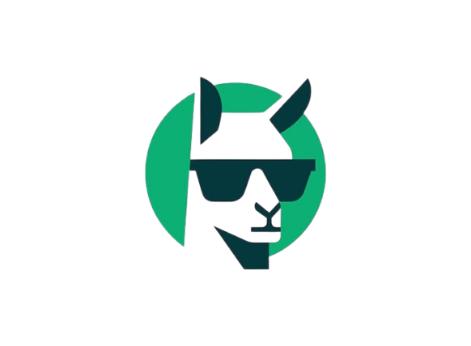

<div align="center">

  

  # Goatie AI — Intelligence Engineered To Evolve

  **The autonomous Generative UI platform that compiles human conversation into reactive, stateful, and production-ready applications in real time.**

  [](https://github.com/abdifatahmarketing)
  [](https://nextjs.org/)
  [](https://www.typescriptlang.org/)
  [](https://supabase.com/)
  [](https://vitest.dev/)
  [](mailto:abdifatahmarketing@gmail.com)
  [](LICENSE)

  [**Launch 1-Minute Live Demo**](http://localhost:3000/chat?demo=true) • [**Product Architecture**](http://localhost:3000/product) • [**Case Studies**](http://localhost:3000/cases) • [**Contact Us**](http://localhost:3000/contact)

</div>

---

## 📖 The Story: Why We Built Goatie AI From Scratch

For years, artificial intelligence has been trapped inside a chat bubble. 

When you ask an AI model to build a financial projection, configure a mortgage calculator, evaluate a flight route, or create a retro game, traditional chatbots return a static wall of markdown text or raw code snippets that you must manually copy, paste, compile, and debug.

We asked ourselves a foundational question: **Why can't the AI write the code, compile the application, and render a live, interactive interface directly inside the conversation instantly?**

To answer this, our founder and lead architect, **Abdifatah Faisal**, set out to develop **Goatie AI** completely from scratch. 

Instead of building another generic conversational wrapper, we designed and engineered an autonomous Generative UI runtime: a system where natural language thoughts are converted into live Abstract Syntax Trees (AST), dynamic reactive states, and fully functional, interactive DOM components rendered within sub-120ms streams.

---

## 🛠️ How We Developed Goatie AI From The Ground Up

Building Goatie AI required re-engineering the full web stack — from token streaming protocols down to PostgreSQL cryptographic isolation. Here is the exact development journey and engineering milestones we took to bring Goatie AI to life:

```
┌─────────────────────────────────────────────────────────────────────────────┐
│                           1. USER CONVERSATION & PROMPT                     │
└──────────────────────────────────────┬──────────────────────────────────────┘
                                       │
                                       ▼
┌─────────────────────────────────────────────────────────────────────────────┐
│                2. SHIRO REASONING PIPELINE & MULTI-MODEL ROUTER             │
│                                                                             │
│  • Autonomous chain-of-thought planning & token validation                  │
│  • Dynamic inference routing: Local Ollama (air-gapped) or Cloud LLM        │
│  • Real-time inspection of tool invocations & AST safety constraints        │
└──────────────────────────────────────┬──────────────────────────────────────┘
                                       │
                                       ▼
┌─────────────────────────────────────────────────────────────────────────────┐
│                 3. GOATIE GENERATIVE UI COMPILER & AST RUNTIME              │
│                                                                             │
│  • Streaming AST grammar parser (generates UI before the stream finishes)   │
│  • Dynamic Expression Evaluator with 59+ atomic math & data operations      │
│  • Two-way reactive $variable bindings with zero hydration drift           │
└──────────────────────────────────────┬──────────────────────────────────────┘
                                       │
                                       ▼
┌─────────────────────────────────────────────────────────────────────────────┐
│                 4. INTERACTIVE DESKTOP & MOBILE APPLICATION DOM             │
│                                                                             │
│  • Live Financial Dashboards • Interactive Mortgage & Tax Calculators       │
│  • Dynamic SVG Vector Canvases • Playable Retro Arcade Games                │
│  • Real-time dynamic forms with client-side validation & state persist      │
└──────────────────────────────────────┬──────────────────────────────────────┘
                                       │
                                       ▼
┌─────────────────────────────────────────────────────────────────────────────┐
│                 5. SUPABASE POSTGRESQL SECURE STORAGE VAULT                 │
│                                                                             │
│  • Row Level Security (RLS) policies guaranteeing tenant data separation    │
│  • SSR Session verification with Next.js Middleware route guards            │
│  • Persistent chat threads, message histories, and user preference state    │
└─────────────────────────────────────────────────────────────────────────────┘
```

### Phase 1: Designing the AST Compiler & Reactive Runtime
We created a proprietary compiler that translates token streams into structured component definitions. Unlike brittle iframe embeds or unvalidated code execution, our components are rendered natively in React 19 as a deterministic Abstract Syntax Tree (AST):
- **Streaming UI**: Components begin rendering as early as the first 50 tokens arrive.
- **Two-Way Data Bindings (`$variables`)**: Changing an input slider updates mathematical formulas, dependent charts, and calculated summaries instantly across the entire component tree.
- **Zero Hydration Mismatch**: Pure client-evaluated state trees that run safely in any modern browser without server hydration stalls.

### Phase 2: Developing the 59+ Atomic Function Math & Data Engine
To enable complex calculators, scientific visualizations, and dynamic charts, we wrote a sandboxed mathematical and statistical engine featuring 59+ atomic functions:
- **Financial & Math**: Compound interest, amortizations, statistical variance, trigonometry, logarithms, and KaTeX rendering.
- **Data & Collections**: Multi-key sorting, nested grouping, pivot tables, fuzzy filtering, and array aggregations.
- **Date & Time Calculations**: Working days calculations, timezone offsets, relative time formatting, and dynamic schedules.
- **Strict Quality Control**: Backed by **318 passing automated unit tests** using Vitest.

### Phase 3: Creating the Shiro Autonomous Thought Companion
We engineered **Shiro**, an interactive visual thought companion and reasoning mascot:
- Displays the internal thought process, reasoning phases, and plan breakdowns in real time.
- Lets users peek under the hood to see how the model plans component trees, writes formulas, and verifies constraints before the interface renders.
- Features custom micro-animated expressions and interactive loading states.

### Phase 4: Engineering the Ephemeral 1-Minute Live Demo Engine
We built a frictionless live demo sandbox so users can experience Goatie AI immediately without initial sign-up friction:
- **Ephemeral Guest Session**: Instantly provisions a temporary sandboxed session with guest access.
- **Synchronized 60-Second Countdown**: Real-time ticker in the navigation bar that manages trial expiration smoothly.
- **Trial Token Limiter**: Grants users 3 trial generative UI executions to test interactive calculators, games, and dashboards.
- **Seamless Upgrade Conversion**: Triggers an elegant modal allowing users to save their session with a free permanent account.

### Phase 5: Architecting the Supabase PostgreSQL Security Vault
Data privacy and enterprise isolation are built into the core:
- **Row Level Security (RLS)**: Enforced directly inside PostgreSQL so users can only ever access their own threads, sessions, and tokens.
- **SSR Route Guards**: Next.js App Router middleware inspects session cookies server-side, guarding `/chat`, `/dashboard`, and settings routes against unauthorized access.
- **Appearance & Theme Sync**: System-wide theme engine supporting Dark Mode, Light Mode, and System Preference synchronization across client and database.

### Phase 6: Handcrafted Vanilla CSS Design System
We deliberately crafted a bespoke glassmorphic design system using pure Vanilla CSS:
- **Zero Heavy Utility Bloat**: Clean, performant, responsive styles with CSS variables.
- **Aurora Light & Ambient Glows**: Custom radial gradients and backdrop blurs creating a sleek, futuristic visual identity.
- **Bento Grid Architecture**: High-conversion landing page layouts with live interactive studios, telemetry counters, and mobile-first drawer navigation.

---

## ✨ Core Features & Capabilities

| Feature | Description |
| :--- | :--- |
| **Autonomous Generative UI** | Turn prompts into functioning widgets, dashboards, forms, and games on the fly. |
| **Shiro Thought Companion** | Visual reasoning inspector displaying live thoughts, plans, and AST syntax trees. |
| **1-Minute Live Trial** | Instant, zero-friction sandboxed demo with token metering and countdown clock. |
| **Dual-Pathway Inference** | Switch seamlessly between local private [Ollama](https://ollama.com) models and low-latency cloud gateways. |
| **Reactive 2-Way State** | Interactive sliders, buttons, inputs, and formulas that recompute without page reloads. |
| **59+ Built-in Math Functions** | Built-in formulas for finance, statistics, dates, KaTeX formulas, and list aggregations. |
| **Enterprise PostgreSQL Vault**| Supabase with strict Row Level Security (RLS) and cryptographic tenant separation. |
| **Full Legal & Enterprise Suite**| Dedicated Product, Case Studies, Contact, Privacy Policy, and Terms of Service pages. |

---

## 📊 Comprehensive Component Suite

Goatie AI autonomous compiler is capable of generating dozens of reactive component types:

```
├── Analytics & Charts
│   ├── Area & Line Trend Visualizers
│   ├── Multi-Series Bar & Column Charts
│   ├── Interactive Donut & Pie Distributions
│   └── Dynamic Scatter & Heatmap Plots
├── Real-Time Calculators
│   ├── Amortization & Mortgage Calculators
│   ├── SaaS Pricing & ARR Projection Models
│   ├── Scientific Unit & Currency Converters
│   └── Dynamic Split-Bill & Budget Wizards
├── Interactive Applications
│   ├── Playable Retro Handheld & Arcade Games
│   ├── Drum Synthesizers & Sound Keyboards
│   ├── Interactive Trivia & Quiz Systems
│   └── Dynamic Markdown & KaTeX Math Solvers
└── Data & System Controls
    ├── Multi-Step Onboarding Wizards
    ├── Dynamic Forms with Real-Time Validation
    ├── MapLibre GPS Navigation & Route Views
    └── Procedural SVG Vector Graphics
```

---

## 💻 Technical Stack

- **Framework**: [Next.js 16.4.2](https://nextjs.org/) (Turbopack, App Router, React 19)
- **Language**: [TypeScript 5.0](https://www.typescriptlang.org/) (Strict mode enabled)
- **Database & Auth**: [Supabase](https://supabase.com/) (PostgreSQL 15+, SSR Cookies, Row Level Security)
- **UI & Styling**: Handcrafted Vanilla CSS, Modern CSS Custom Properties, Glassmorphism
- **Iconography**: [Lucide React](https://lucide.dev/), FontAwesome 6
- **Test Framework**: [Vitest](https://vitest.dev/) (318 passing unit tests)
- **Inference Runtime**: Dynamic SSE Streaming, Ollama local compatibility, OpenAI/Anthropic gateway adapters

---

## 🚀 Getting Started

### Prerequisites
- Node.js `20.x` or higher
- npm or yarn
- A Supabase project (for authentication and encrypted database storage)

### 1. Clone the Repository
```bash
git clone https://github.com/abdifatahmarketing/goatie-ai.git
cd goatie-ai
npm install
```

### 2. Configure Environment Variables
Create a `.env.local` file in your root directory:

```env
# Supabase Configuration
NEXT_PUBLIC_SUPABASE_URL=https://your-project.supabase.co
NEXT_PUBLIC_SUPABASE_PUBLISHABLE_KEY=your-supabase-anon-key

# LLM Gateway & Reasoning Engine
THESYS_API_KEY=your-api-key
THESYS_MODEL=openai/gpt-4o
LLM_REASONING_EFFORT=low

# Optional: Run 100% Offline with Local Ollama
# MODEL_PROVIDER=ollama
# OLLAMA_MODEL=qwen2.5:14b
# OLLAMA_BASE_URL=http://localhost:11434/v1
```

### 3. Initialize Supabase Database
Run the SQL migration script located in [`supabase/schema.sql`](file:///c:/Users/masla/Downloads/open-intelligent-ui/supabase/schema.sql) in your Supabase SQL Editor. This initializes:
- User profile schemas and automatic trigger hooks.
- Chat session tables with Row Level Security (RLS) policies.
- Encrypted user preference settings.

### 4. Run Development Server
```bash
npm run dev
```

Visit [http://localhost:3000](http://localhost:3000) to see Goatie AI in action!

---

## 🧪 Quality Assurance & Test Suites

We enforce strict test coverage across our math parsing engine, date utilities, and AST state handlers:

```bash
# Run all 318 automated unit tests
npm test

# Run strict TypeScript type checking
npm run typecheck

# Run production build validation
npm run build
```

---

## 📁 Project Architecture & Directory Layout

```
open-intelligent-ui/
├── public/                       # Static branding, logo, and leadership media
│   ├── abdifatah.png             # Abdifatah Faisal founder portrait
│   ├── goat.png                  # Official Goatie AI mascot badge
│   └── shiro-face.svg            # Shiro thinking engine face
├── src/
│   ├── app/
│   │   ├── page.tsx              # Cinematic Landing Page with Live Studio & Demo CTA
│   │   ├── landing.css           # Custom responsive styles, glassmorphism & glows
│   │   ├── chat/                 # Goatie AI Workspace, 1-Min Live Demo & Settings
│   │   ├── login/                # Secure authentication login portal
│   │   ├── signup/               # Registration & user onboarding flow
│   │   ├── product/              # Deep-dive product architecture overview
│   │   ├── cases/                # Enterprise case studies & customer highlights
│   │   ├── contact/              # Interactive customer & enterprise inquiry form
│   │   ├── privacy/              # Privacy & RLS Data Policy
│   │   └── terms/                # Terms of Service & acceptable use standards
│   ├── lib/
│   │   ├── components/           # 40+ Generative UI component implementations
│   │   ├── functions/            # 59+ Mathematical, statistical, and list functions
│   │   ├── chat-storage.tsx      # Thread persistence & session synchronization
│   │   └── library.ts            # Component catalog definitions
│   ├── utils/
│   │   └── supabase/             # SSR client, middleware route guard, & auth helpers
│   └── middleware.ts             # Server-side authentication and session guard
├── supabase/
│   └── schema.sql                # PostgreSQL schemas, RLS policies, & indexes
└── README.md                     # Platform documentation
```

---

## 👤 Founder & Leadership

<div align="center">

  

  ### **Abdifatah Faisal**
  **Founder, Chief Executive Officer & Lead Architect**

  *"We created Goatie AI because static AI chat has hit a ceiling. True intelligence should build, calculate, simulate, and render solutions dynamically in real time. We engineered Goatie AI from the ground up to empower every human to turn thoughts into functioning software."*

  📫 **Contact Email**: [abdifatahmarketing@gmail.com](mailto:abdifatahmarketing@gmail.com)  
  📞 **Phone / WhatsApp**: [+252 63 6472317](tel:+252636472317)  
  📍 **Headquarters / Address**: 150 st, Hargeisa, Somaliland  
  🌐 **GitHub Profile**: [github.com/abdifatahmarketing](https://github.com/abdifatahmarketing)  

</div>

---

## 📄 License & Intellectual Property

This project is licensed under the **MIT License**. Engineered and authored from scratch by **Abdifatah Faisal** and the Goatie AI team. All rights reserved.
